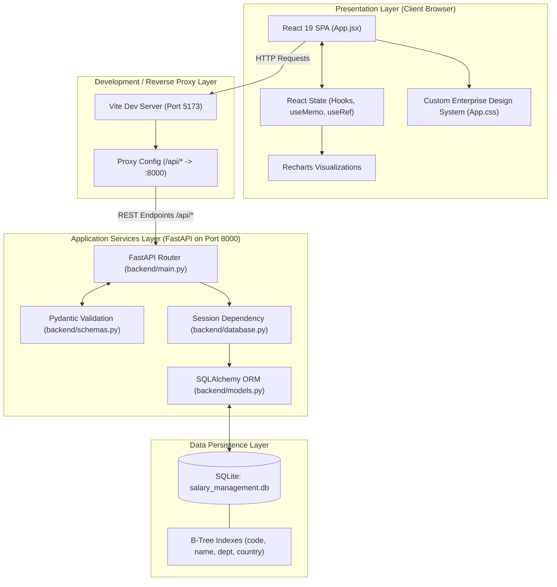
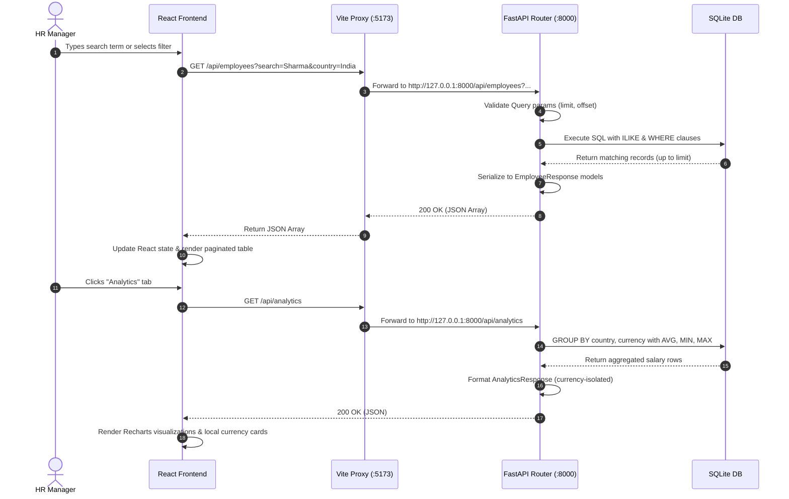

# ACME Salary Management System — System Architecture & Technical Design

## 1. Architectural Overview

The **ACME Salary Management System** is structured as a decoupled, multi-tier web application comprising:
1. **Frontend Presentation Tier**: Modern React 19 single-page application (SPA) bundled with Vite 8, utilizing Vanilla CSS custom properties and Recharts data visualizations.
2. **Backend Application Tier**: High-performance asynchronous REST API built with FastAPI, using Pydantic v2 schemas for strict contract validation and error handling.
3. **Data Persistence Tier**: Relational database managed through SQLAlchemy 2 ORM, backed by SQLite with B-Tree indexes for fast indexing and deterministic local development.



---

## 2. Component Specifications

### 2.1 Frontend Architecture
- **Framework**: React 19 (`react`, `react-dom`).
- **Build Tool & Bundler**: Vite 8 (`@vitejs/plugin-react`).
- **Icons**: Lucide React (`lucide-react`) for SVG icons (Search, Wallet, Users, Globe, Download, Trash, etc.).
- **Charting Engine**: Recharts (`ResponsiveContainer`, `BarChart`, `Bar`, `XAxis`, `YAxis`, `Tooltip`, `Legend`, `CartesianGrid`).
- **Styling Paradigm**:
  - Semantic Vanilla CSS with enterprise design tokens declared in `:root` (`--primary: #4f46e5;`, `--bg-app: #f8fafc;`, `--radius-lg: 12px;`, etc.).
  - Custom `<select>` appearance override (`appearance: none;`) with inlined SVG chevron vectors for all dropdown menus (`.stat-select`, `.filter-select`, `.form-group select`).
  - Dark SaaS navigation sidebar with active indicator pills and status avatars.
- **State Management**:
  - React local hooks (`useState`, `useEffect`, `useMemo`, `useRef`).
  - Set-based row selection (`selectedIds = new Set()`) providing $O(1)$ lookups for table row highlighting and bulk actions.
  - DOM ref (`selectAllRef`) bound to the table header checkbox to manage HTML5 `indeterminate` state.
- **Development Reverse Proxy**:
  - Configured in `frontend/vite.config.js` to route all `/api` calls to `http://127.0.0.1:8000`, eliminating cross-origin resource sharing (CORS) friction during local development.

### 2.2 Backend Architecture
- **Framework**: FastAPI (running on Uvicorn ASGI server).
- **Object Relational Mapper**: SQLAlchemy 2.0 (`declarative_base`, `sessionmaker`, `create_engine`).
- **Serialization & Validation**: Pydantic v2 (`BaseModel`, `Field`, `ConfigDict`).
- **Concurrency & Threads**:
  - SQLite configured with `check_same_thread: False` to support FastAPI's multi-threaded worker dispatch.
  - Per-request database session management via generator dependency `get_db()`.
- **API Endpoints**:
  | Method | Endpoint | Description | Request Schema | Response Schema | Status Code |
  |---|---|---|---|---|---|
  | `GET` | `/` | API root status banner | None | `{"message": str}` | 200 OK |
  | `GET` | `/health` | Health-check probe | None | `{"status": "healthy"}` | 200 OK |
  | `POST` | `/api/employees` | Create employee record | `EmployeeCreate` | `EmployeeResponse` | 201 Created (409 Conflict) |
  | `GET` | `/api/employees` | Search & filter directory | Query Params (`search`, `country`, `department`, `offset`, `limit`) | `list[EmployeeResponse]` | 200 OK |
  | `GET` | `/api/employees/{id}` | Fetch employee by ID | URL parameter `id` | `EmployeeResponse` | 200 OK (404 Not Found) |
  | `PUT` | `/api/employees/{id}` | Update employee record | `EmployeeCreate` | `EmployeeResponse` | 200 OK (404, 409) |
  | `DELETE` | `/api/employees/{id}` | Delete employee record | URL parameter `id` | `{"message": str}` | 200 OK (404 Not Found) |
  | `GET` | `/api/analytics` | Currency-safe salary analytics | None | `AnalyticsResponse` | 200 OK |

---

## 3. Database Schema & Data Modeling

### 3.1 Relational Schema (`employees` table)

```sql
CREATE TABLE employees (
    id INTEGER NOT NULL PRIMARY KEY AUTOINCREMENT,
    employee_code VARCHAR(20) NOT NULL UNIQUE,
    full_name VARCHAR(100) NOT NULL,
    department VARCHAR(80) NOT NULL,
    country VARCHAR(80) NOT NULL,
    currency VARCHAR(3) NOT NULL,
    salary NUMERIC(12, 2) NOT NULL,
    hire_date DATE NOT NULL
);

-- B-Tree Performance Indexes
CREATE INDEX ix_employees_id ON employees (id);
CREATE UNIQUE INDEX ix_employees_employee_code ON employees (employee_code);
CREATE INDEX ix_employees_full_name ON employees (full_name);
CREATE INDEX ix_employees_department ON employees (department);
CREATE INDEX ix_employees_country ON employees (country);
```

### 3.2 Field Constraints & Rationale
- **`employee_code`**: Unique business identifier (e.g., `ACME00001`). Indexed with a unique constraint to prevent duplicate employee onboarding.
- **`full_name`**: Indexed to accelerate prefix and wildcard `LIKE` search queries.
- **`salary`**: Stored as `Numeric(12, 2)` mapped to Python `Decimal`. Guarantees exact fractional cents/pence/paise representation without binary floating-point inaccuracy.
- **`currency`**: Standard 3-character ISO 4217 code (`INR`, `USD`, `GBP`, `EUR`, `SGD`).
- **`department` & `country`**: Indexed for low-latency filtering in the employee directory toolbar.

---

## 4. API Request Flow & Lifecycle



---

## 5. Synthetic Seeding Strategy (10,000 Records)

The project includes an idempotent seeding script (`seed.py`) designed to stress-test the system with scale data:
- **Record Volume**: Exactly 10,000 synthetic employee records.
- **Distribution Matrix**:
  - **5 Countries & Currencies**: India (`INR`), United States (`USD`), United Kingdom (`GBP`), Germany (`EUR`), Singapore (`SGD`) assigned in round-robin sequence `(i - 1) % 5`.
  - **6 Departments**: `Engineering`, `Human Resources`, `Finance`, `Sales`, `Marketing`, `Operations` distributed via `(i - 1) % 6`.
  - **100 Name Combinations**: Formed from 10 distinct first names (`Arun`, `Priya`, `David`, `Aisha`, etc.) and 10 surnames (`Sharma`, `Smith`, `Patel`, `Wilson`, etc.) combined modularly (`i * 7`).
- **Realistic Attributes**:
  - Unique codes: Zero-padded serial codes (`ACME00001` to `ACME10000`).
  - Nominal Salaries: Randomly generated between 30,000 and 150,000 nominal units per country.
  - Hire Dates: Distributed across the past ~7 years (`today - timedelta(days=i % 2500)`).
- **Execution Efficiency**:
  - Built using Python model instantiations in a single list batch.
  - Persisted in a single transaction via `db.add_all(batch)` and `db.commit()`, completing insertion in ~1.5 seconds.
  - Guarded against duplicate seeding: Checks `db.query(Employee.id).first()`.

---

## 6. Testing Architecture

Testing is implemented in `backend/tests/test_api.py` using **Pytest** and FastAPI's `TestClient`:
- **Isolation Strategy**:
  - Test suite creates an in-memory SQLite database (`sqlite://`) with `StaticPool` and `check_same_thread: False`.
  - Overrides FastAPI's `get_db` dependency via `app.dependency_overrides[get_db] = override_get_db`.
  - Automatic database teardown and recreation before every test via `setup_function()`.
- **Test Coverage (9 Automated Tests)**:
  1. `test_health_endpoint`: Asserts HTTP 200 and `"status": "healthy"`.
  2. `test_create_and_get_employee`: Verifies creation and retrieval roundtrip.
  3. `test_duplicate_employee_code_is_rejected`: Asserts HTTP 409 Conflict on duplicate `employee_code`.
  4. `test_invalid_salary_is_rejected`: Asserts HTTP 422 Unprocessable Entity when `salary <= 0`.
  5. `test_search_employees`: Verifies case-insensitive search filtering.
  6. `test_salary_analytics`: Confirms analytics payload returns total count.
  7. `test_salary_analytics_calculates_local_averages_per_currency_group`: Validates local averages (e.g. ₹50,000 INR vs $100,000 USD) calculated strictly within currency partitions.
  8. `test_unconverted_salaries_are_isolated_and_not_blended_into_global_average`: Verifies total absence of naive global blended fields (`global_average`, `average_salary`).
  9. `test_cannot_incorrectly_rank_unconverted_salaries`: Proves nominal ranking without currency conversion is invalid and rejected.

---

## 7. Performance & Scalability Considerations

1. **Database Indexing**:
   - Filter and search operations leverage B-Tree indexes on `employee_code`, `full_name`, `department`, and `country`, avoiding full table scans.
2. **Server-Side Pagination**:
   - The `/api/employees` endpoint enforces pagination bounds (`offset >= 0`, `1 <= limit <= 100`).
3. **Database Aggregations**:
   - The `/api/analytics` endpoint delegates computation of `COUNT`, `AVG`, `MIN`, and `MAX` to the SQLite C-engine via SQL `GROUP BY`, executing across 10,000 rows in < 15ms.
4. **Client Rendering Performance**:
   - DOM virtualization via client-side page slicing (`pageSize` default 10, up to 50) prevents excessive browser reflows.
   - Memoized computations (`useMemo`) for country analytics lookups and page ID sets.

---

## 8. Production Deployment Considerations

| Aspect | Current Development Configuration | Recommended Production Configuration |
|---|---|---|
| **Frontend Server** | Vite Dev Server with HMR (`localhost:5173`) | Production static build (`dist/`) hosted on CDN (Cloudflare Pages, Vercel, AWS S3 + CloudFront) |
| **Backend Server** | Single-process Uvicorn with `--reload` | Containerized FastAPI on Docker, multi-worker Uvicorn managed by Gunicorn (`-w 4 -k uvicorn.workers.UvicornWorker`) |
| **Database** | Local file SQLite (`salary_management.db`) | Managed PostgreSQL (Amazon RDS, Supabase, Cloud SQL) with connection pooling (PgBouncer) |
| **Database Migrations** | `Base.metadata.create_all()` on startup | Managed schema migrations using **Alembic** (`alembic upgrade head`) |
| **Reverse Proxy / SSL** | Vite local proxy, plain HTTP | Nginx or AWS Application Load Balancer with automated TLS/SSL certificate termination |
| **Environment Secrets** | Hardcoded dev constants (`sqlite:///...`) | Environment variables loaded via `pydantic-settings` / `.env` file |

---

## 9. Implemented vs. Planned Improvements

| Feature / Domain | Implemented in Current System | Planned Future Improvement |
|---|---|---|
| **Employee CRUD** | ✅ Full Create, Read, Update, Delete with Pydantic validation | Soft deletion / archiving with audit history |
| **Currency Handling** | ✅ Currency-isolated group analytics (zero blending) | Integration with authenticated live FX conversion API |
| **Directory Search** | ✅ Case-insensitive search on Name and Code | Full-text search (FTS5 in SQLite or PostgreSQL `tsvector`) |
| **Bulk Actions** | ✅ Multi-row select, indeterminate state, CSV export, batch delete | Bulk salary adjustments by percentage or department |
| **Data Visualization** | ✅ Recharts bar charts for regional ranges and distributions | Historical time-series charts of payroll expenditure |
| **Authentication** | ❌ Open internal HR dashboard (no auth required) | OAuth2 / JWT login with Role-Based Access Control (RBAC) |
| **Database Storage** | ✅ SQLite with index optimization for 10k synthetic rows | Migration to production PostgreSQL with Alembic scripts |
| **Deployment** | ❌ Local development execution only (not deployed) | Production CI/CD pipeline targeting container cluster |
